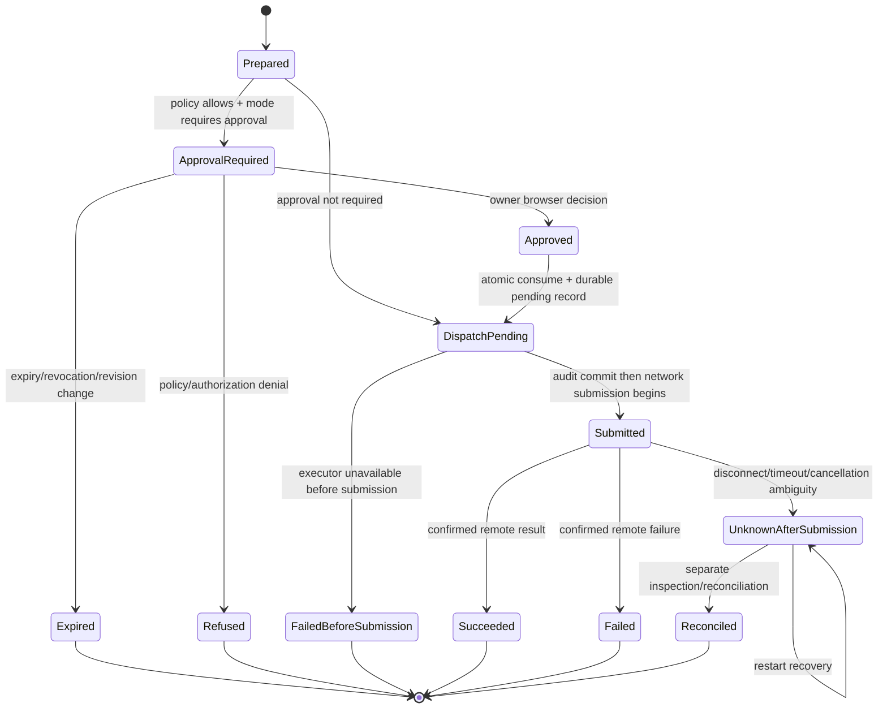

# Spec 06 durable approval and dispatch state machine

Step 06-01 defines the durable state transitions for approvals, dispatch and audit. It is a protocol and persistence design; it does not claim exactly-once execution over SSH.

## Records and invariants

An immutable operation intent binds installation, owner, server ID, target revision, tool/action, canonical arguments, risk, approval mode in effect, created/expiry timestamps and a digest. The digest is the value shown to the approver and checked again at submission. Agent text is descriptive metadata only. Approval evidence binds the same digest, owner, authenticated browser session, CSRF check and decision time. `confirm: true` never creates evidence.

The operation/audit record has these states:

`Prepared`, `ApprovalRequired`, `Approved`, `Expired` and `Refused` are pre-submission states. `DispatchPending` means an approval has been consumed and a durable dispatch record exists, but the remote command has not been proven submitted. `Submitted` is written immediately before the executor call. Any failure after that boundary is `UnknownAfterSubmission` unless a transport result proves success or failure. Unknown records are never replayed automatically and never reset to pending.

## Transaction boundaries and crash matrix

The database transaction for prepare validates current policy/target revision and inserts the immutable intent. The approval transaction validates browser identity, CSRF, digest, revision, expiry and mode, then records evidence. The dispatch transaction atomically consumes the approval and inserts `DispatchPending` plus the redacted audit row under one database commit. No remote call occurs inside a database transaction. After commit, the executor re-resolves target/policy and records `Submitted` immediately before network submission.

| Crash/failure point | Durable state after recovery | Safe action |
| --- | --- | --- |
| Before intent commit | no operation | client may prepare again |
| After intent, before approval | `ApprovalRequired`/`Prepared` | wait, expire or refuse |
| During approval transaction | old state or committed `Approved` | idempotent status read; never duplicate evidence |
| After approval commit, before dispatch commit | `Approved` | retry dispatch gate after fresh checks |
| After consume/pending commit, before executor call | `DispatchPending` | mark failed-before-submission only if executor proves not called; otherwise unknown |
| During/after network submission | `Submitted` or `UnknownAfterSubmission` | reconcile by inspection; never replay blindly |
| After confirmed result, before final audit update | `Submitted` with provider evidence | recovery records the confirmed result idempotently |

The executor and audit repository must expose a submission boundary explicitly. A database commit cannot make a remote SSH side effect exactly once; the design therefore promises at-most-one approval consumption and no automatic replay, while allowing an operator to reconcile an unknown outcome.

## Redaction, retention and recovery

Store canonical arguments only after secret-key/value validation; redact credential material, bearer tokens, cookies, CSRF values, private keys, passwords and provider connection strings before persistence or logs. Keep operation metadata, digest, risk, target ID/revision, status and timestamps by default. Do not store stdout/stderr by default. If an installation enables output retention, store bounded, explicitly redacted output with a separate retention class and deletion job. Foreign-owner and authorization errors contain no server labels, hostnames or revision metadata.

On startup, a recovery worker finds `DispatchPending` and `Submitted` records without a terminal outcome. It records `UnknownAfterSubmission` unless a durable provider receipt proves the request never crossed the submission boundary. It emits an audit event and leaves reconciliation to a separately authorized inspection workflow. Approval mode or server revision changes invalidate unused approvals; consumed approvals remain historical and cannot be restored.

## Required tests for later steps

06-02/06-03 must cover concurrent one-time consumption, altered digest/arguments, foreign owner, expired approval, revoked browser session, mode/revision change and confirm-only attempts. 06-04/06-05 must inject crashes at every table row above, simulate audit outage before dispatch, verify redaction/retention, and assert that exactly one dispatch attempt is possible per consumed approval without claiming exactly-once remote execution.
